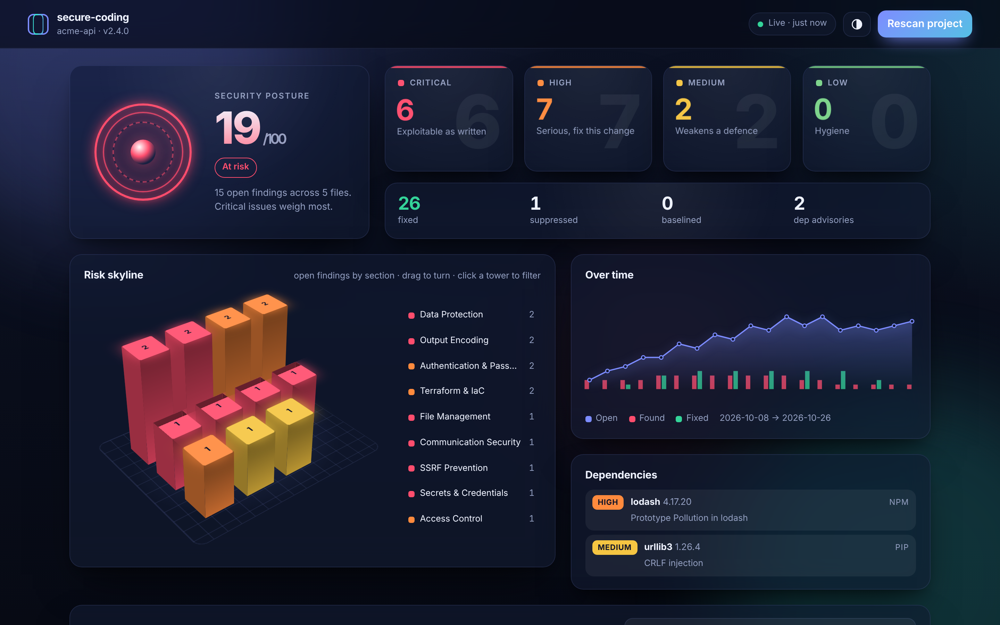
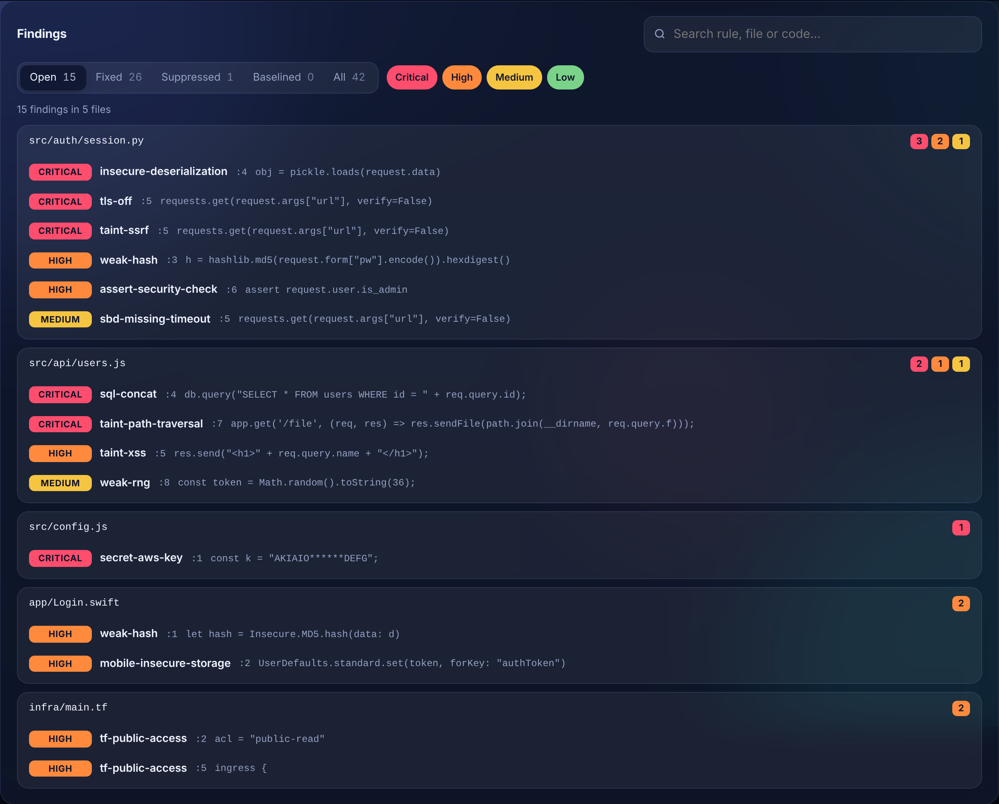
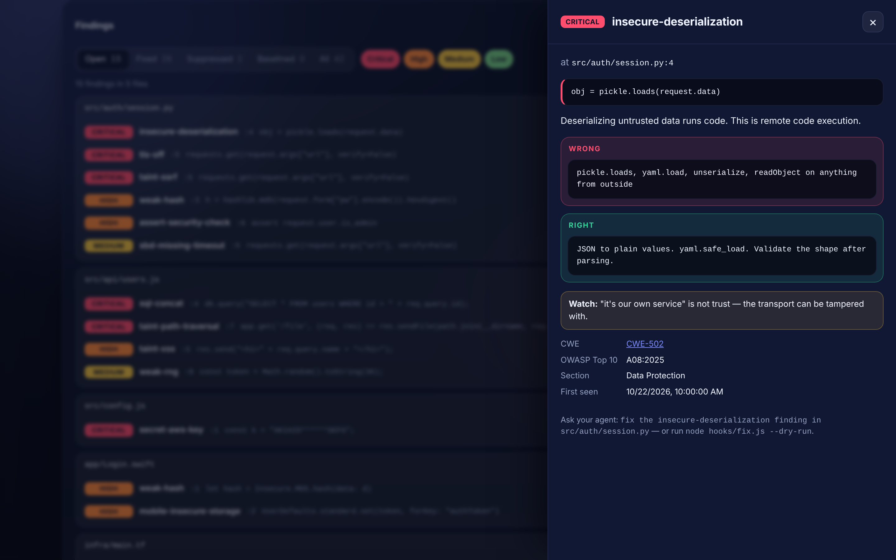
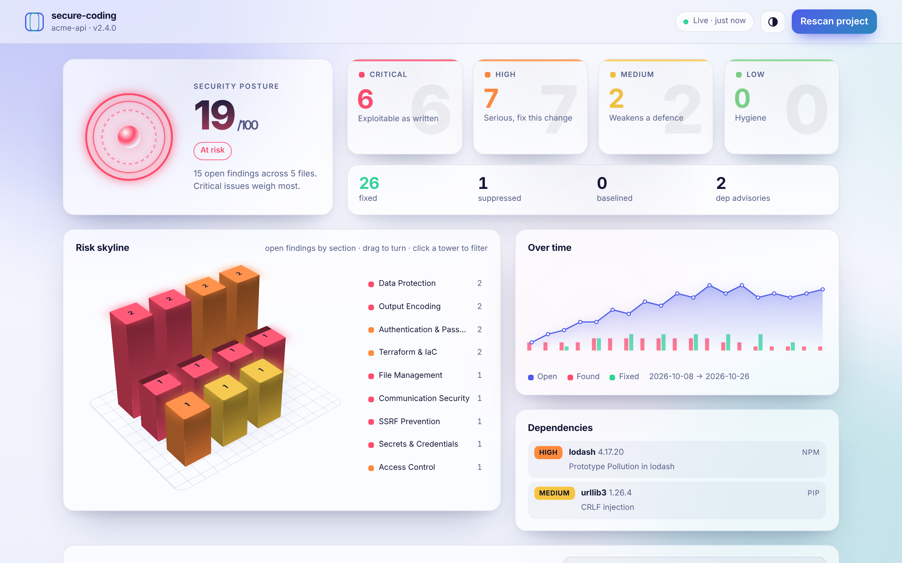

<div align="center">

# secure-coding

**Security checks for code written by AI agents — while it is being written.**

[](hooks/test.js)
[](checks/owasp-top10-2025.md)
[](checks/llm-top10.md)
[](package.json)
[](#license)



</div>

An AI agent writes a file. secure-coding scans it within milliseconds, and if
something is wrong — a SQL string built from user input, a hardcoded key, a
package name the model made up — the agent gets the fix before it moves on.
Before a commit, it asks the questions a scanner cannot answer, such as "who is
allowed to read this record?".

- **403 patterns** mapped to CWE and the OWASP Top 10:2025, across 13 language templates
- **Taint tracking**: follows request data into SQL, files, shell, URLs, HTML and LLM system prompts
- **Dependency guard**: blocks packages that do not exist or were published days ago
- **Secrets**: in code, in `.json` files, and in git history
- **Dashboard**: a local web view of every finding (screenshot above)
- **Zero runtime dependencies**: plain Node.js 18+

## Install

```bash
npx github:nnguyensky/secure-coding#v2.4.0 --global --agent all --mcp
```

This copies the skill to `~/.secure-coding`, adds git hooks to the current
repository, writes rules for your agents, and registers the MCP server. Use the
[latest release tag](https://github.com/nnguyensky/secure-coding/tags) in
place of `v2.4.0`.

| Flag | What it does |
|---|---|
| `--agent <name>` | `claude`, `cursor`, `windsurf`, `cline`, `antigravity`, `opencode`, or `all` |
| `--global` | Installs to `~/.secure-coding`, where the git hooks find it. Needed with `npx` |
| `--mcp` | Registers the MCP server for your IDE |
| `--target <dir>` | Repository to set up (default: current directory) |
| `--yes` | No questions |

From a clone instead:

```bash
git clone https://github.com/nnguyensky/secure-coding.git
cd secure-coding && node install.js
```

**Check it works:** ask your agent to write a query by joining strings. It
should refuse and write a parameterized one. If not, see
[INSTALLATION.md](INSTALLATION.md).

## What runs, and when

Nothing runs in the background. Each check is tied to something you already do.

| When | What runs | Result |
|---|---|---|
| The agent writes or edits a file | `scan.js` (Claude Code hook) | ~1 ms. Silent if clean. Otherwise the agent sees the finding and its fix. For an edit, only the lines it wrote can block |
| The agent adds a dependency | `deps.js` (same hook) | Blocks a package that does not exist or is under 30 days old |
| `git commit` | `scan.js --staged`, then `gate.js --check` | Blocks on findings, or on unanswered review questions when the change handles requests |
| `git push` | `audit.js`, `summary.js` | Blocks on a vulnerable dependency or leftover findings |
| Pull request | GitHub Actions | Runs everything, uploads SARIF so findings appear on the diff |

## Dashboard

```bash
node hooks/serve.js                # live, opens in your browser
node hooks/report.js --dashboard   # one HTML file you can open offline
```

The live view refreshes every few seconds and can rescan the project. Click a
tower in the 3D chart to filter by section; click a finding to see why it is
dangerous, the wrong and the right code, and its CWE.

<table>
<tr>
<td width="50%"></td>
<td width="50%"></td>
</tr>
<tr>
<td colspan="2"></td>
</tr>
</table>

The server is only for you: it listens on `127.0.0.1`, needs a random token
that is in the link it prints, rejects other host names and cross-site
requests, and can only rescan — it never changes your files. The page is one
self-contained file (React 19, built from [`dashboard/`](dashboard)), so
nothing is downloaded and the package still installs no dependencies.

## Using it on an existing codebase

Old code has old findings. Record them once so only new ones block:

```bash
node hooks/scan.js --baseline
git add .securecoding-baseline.json
```

Findings are matched by file, rule and line text, so moving code around does
not bring them back, but editing a baselined line does. `--no-baseline` shows
everything.

## Dependencies an agent adds

Models sometimes suggest packages that do not exist. Attackers register those
names so the next install runs their code. `deps.js` checks every dependency a
change adds to `package.json`, `requirements*.txt` or `pyproject.toml`:

| Finding | Meaning | Blocks |
|---|---|---|
| `dep-not-found` | Not on npm or PyPI — probably made up | yes |
| `dep-new-package` | First published less than 30 days ago | yes |
| `dep-install-script` | Runs a script when installed | no |
| `dep-sdist-only` | No wheel, so `setup.py` runs on install | no |

Only package names are sent, and only to the public registry they would come
from. Names that resolve from a private registry (`.npmrc` scopes, pip
`--index-url`) or that you list in `"deps": { "private": [...] }` are never
sent. Set `SECURE_CODING_DEPS_OFFLINE=1` to send nothing.

## Secrets in history

```bash
node hooks/scan.js --history
```

Finds keys in past commits, including ones already deleted from the code, and
says whether each is still in `HEAD`. A deleted key is still in every clone:
rotate it.

## The Done Gate

Some bugs are the absence of code: a record fetched by ID with no ownership
check, a route with no guard. No pattern can see those. So when a commit
touches request handling, it is blocked until four questions are answered:

| Question | Asks |
|---|---|
| `ownership` | What limits each record fetched by ID to the caller? |
| `authorization` | Which guard stops an unauthenticated caller on each new route? |
| `taint` | Where does each request value end up? |
| `failure-direction` | If the auth check throws, is the request denied? |

```bash
node hooks/gate.js --answer ownership "findFirst({ where: { id, userId } })"
node hooks/gate.js --status   # what is left
node hooks/gate.js --adr      # the answers, ready to paste into the PR
```

"N/A — reason" is accepted; "yes" is not. Docs-only and test-only commits are
not asked. When an agent answers, this is self-review — paste `--adr` into the
pull request so a person reads it. Turn it off with
`git config secure-coding.gate false`.

## Configuration

`.securecodingrc.json` in the repository root. Everything is optional.

```json
{
  "failOn": "high",
  "ignorePaths": ["tests/**", "fixtures/**"],
  "ignorePatterns": [],
  "hookScope": "changed",
  "baseline": ".securecoding-baseline.json",
  "audit": { "ecosystems": ["npm", "pip"], "failOnAdvisory": "high", "failOnSkipped": false },
  "deps": { "minAgeDays": 30, "allow": [], "private": ["@acme/*"] }
}
```

To silence one reviewed finding, name the rule and give a reason on the same line:

```js
const r = eval(expr); // secure-coding-ignore: eval -- input is a fixed math grammar
```

`all` is not accepted. Every suppression shows in the report and in SARIF.

To skip every check for one commit: `git commit --no-verify`.

## Commands

All commands are plain Node. Exit code `0` means clean, `2` means findings, `64` means wrong usage.

| Command | Does |
|---|---|
| `node hooks/scan.js --staged` | Scan staged files (also `--all`, `--diff`, `--files <paths>`) |
| `node hooks/scan.js --baseline` | Record current findings as known |
| `node hooks/scan.js --history` | Secrets in git history |
| `node hooks/deps.js` | Check dependencies added since `HEAD` (`--diff origin/main` in CI) |
| `node hooks/audit.js` | Known advisories in lock files across 9 ecosystems (`npm`, `pnpm`, `yarn`, `pip`, `cargo`, `go`, `bundler`, `composer`, `dotnet`). `--strict` fails when one cannot be checked |
| `node hooks/fix.js --dry-run` | Show automatic fixes line by line; `--apply` writes them |
| `node hooks/fix.js --suggest <id>` | The fix guidance for one rule |
| `node hooks/gate.js --check` | The Done Gate (`--grill` prints the questions to ask before coding) |
| `node hooks/serve.js` | Live dashboard |
| `node hooks/report.js` | HTML report; `--sarif`, `--markdown`, `--dashboard` |
| `node hooks/sbom.js --ai --vex` | CycloneDX 1.5 / SPDX 2.3 SBOM with AI-SBOM fields and VEX |
| `node hooks/clean.js --all` | 14 clean-code rules |
| `node hooks/summary.js` | One line: open, fixed, suppressed |
| `node hooks/test.js` | Self-test |

Fix guidance lives in [`checks/fixes.md`](checks/fixes.md) — 155 blocks, every one tagged
with its CWE and OWASP category, each with wrong code, right code and what to watch for.

## MCP server

`node mcp/server.js` gives agents 13 security tools over MCP (stdio, no dependencies).
It also serves the guidance as resources (`secure-coding://fix/<id>`,
`secure-coding://checks/<name>`) and two prompts: `secure_design_review` and `fix_finding`.

| Tool | Use it to |
|---|---|
| `secure_code_scan` | Scan a snippet or files |
| `explain_finding` | Explain a finding and its fix |
| `secure_code_autofix` | Get or apply a fix |
| `check_dependencies` | Check packages before installing them |
| `security_dependency_audit` | Look up known advisories |
| `scan_git_history` | Find secrets in past commits |
| `get_security_frontier` | Get the questions to ask before building a feature |
| `record_security_decision` / `check_done_gate` | Answer and check the Done Gate |
| `open_dashboard` | Start the dashboard and get its link |
| `generate_ai_sbom`, `clean_code_lint`, `security_summary` | SBOM, lint, status |

```json
{
  "mcpServers": {
    "secure-coding": { "command": "node", "args": ["/path/to/secure-coding/mcp/server.js"] }
  }
}
```

## Agent setup

`install.js --agent <name>` writes these for you. They all say the same thing:
read `SKILL.md` before writing, scan after, answer the Done Gate before saying
"done".

<details>
<summary>Claude Code — scan on every write</summary>

`~/.claude/settings.json`:

```json
{
  "hooks": {
    "PostToolUse": [
      {
        "matcher": "Write|Edit|MultiEdit|NotebookEdit",
        "hooks": [{ "type": "command", "command": "node \"$HOME/.claude/skills/secure-coding/hooks/scan.js\"" }]
      }
    ]
  }
}
```
</details>

<details>
<summary>Cursor, Windsurf, Cline, Antigravity, OpenCode</summary>

| Agent | File |
|---|---|
| Cursor | `.cursor/rules/secure-coding.mdc` |
| Windsurf | `.windsurfrules` |
| Cline | `.clinerules` |
| Antigravity | `AGENTS.md` |
| OpenCode | `.opencode/skills/secure-coding` (link to the skill) |

See [INSTALLATION.md](INSTALLATION.md) for the exact contents.
</details>

<details>
<summary>pre-commit framework</summary>

```yaml
repos:
  - repo: https://github.com/nnguyensky/secure-coding
    rev: v2.4.0
    hooks:
      - id: secure-coding-scan
      - id: secure-coding-gate
```
</details>

## CI

Copy [`.github/workflows/security-scan.yml`](.github/workflows/security-scan.yml).
It runs the tests on Linux, macOS and Windows, scans the files a pull request
changes, checks the dependencies it adds, audits lock files, and uploads SARIF
to GitHub code scanning.

## Language templates

Copy-ready secure versions of 25 common controls in 13 language templates.
`N/A` marks a control that does not apply (C has no cookies).

<details>
<summary>Show the matrix</summary>

| # | Security Control | TS | JS | Py | Go | Rs | Java | Kt | Swift | C# | C | PHP | Rb | Sh |
|:--|:---|:---:|:---:|:---:|:---:|:---:|:---:|:---:|:---:|:---:|:---:|:---:|:---:|:---:|
| 1 | Parameterized Query | ✅ | ✅ | ✅ | ✅ | ✅ | ✅ | ✅ | ✅ | ✅ | ✅ | ✅ | ✅ | ✅ |
| 2 | Password Hashing | ✅ | ✅ | ✅ | ✅ | ✅ | ✅ | ✅ | ✅ | ✅ | ✅ | ✅ | ✅ | ✅ |
| 3 | Authenticated Encryption | ✅ | ✅ | ✅ | ✅ | ✅ | ✅ | ✅ | ✅ | ✅ | ✅ | ✅ | ✅ | ✅ |
| 4 | Secure Random | ✅ | ✅ | ✅ | ✅ | ✅ | ✅ | ✅ | ✅ | ✅ | ✅ | ✅ | ✅ | ✅ |
| 5 | Constant-Time Comparison | ✅ | ✅ | ✅ | ✅ | ✅ | ✅ | ✅ | ✅ | ✅ | ✅ | ✅ | ✅ | ✅ |
| 6 | Secure Temp Files | ✅ | ✅ | ✅ | ✅ | ✅ | ✅ | ✅ | ✅ | ✅ | ✅ | ✅ | ✅ | ✅ |
| 7 | Secure Cookie Flags | ✅ | ✅ | ✅ | ✅ | ✅ | ✅ | ✅ | ✅ | ✅ | N/A | ✅ | ✅ | N/A |
| 8 | Safe Shell Execution | ✅ | ✅ | ✅ | ✅ | ✅ | ✅ | ✅ | ✅ | ✅ | ✅ | ✅ | ✅ | ✅ |
| 9 | Strict Input Validation | ✅ | ✅ | ✅ | ✅ | ✅ | ✅ | ✅ | ✅ | ✅ | ✅ | ✅ | ✅ | ✅ |
| 10 | Output Encoding | ✅ | ✅ | ✅ | ✅ | ✅ | ✅ | ✅ | ✅ | ✅ | N/A | ✅ | ✅ | N/A |
| 11 | TLS Configuration | ✅ | ✅ | ✅ | ✅ | ✅ | ✅ | ✅ | ✅ | ✅ | N/A | ✅ | ✅ | N/A |
| 12 | Secrets via Env/Vault | ✅ | ✅ | ✅ | ✅ | ✅ | ✅ | ✅ | ✅ | ✅ | ✅ | ✅ | ✅ | ✅ |
| 13 | Safe Error Handling | ✅ | ✅ | ✅ | ✅ | ✅ | ✅ | ✅ | ✅ | ✅ | ✅ | ✅ | ✅ | ✅ |
| 14 | Secure Logging | ✅ | ✅ | ✅ | ✅ | ✅ | ✅ | ✅ | ✅ | ✅ | ✅ | ✅ | ✅ | ✅ |
| 15 | File Upload / Traversal | ✅ | ✅ | ✅ | ✅ | ✅ | ✅ | ✅ | ✅ | ✅ | N/A | ✅ | ✅ | N/A |
| 16 | Open Redirect Validation | ✅ | ✅ | ✅ | ✅ | ✅ | ✅ | ✅ | ✅ | ✅ | N/A | ✅ | ✅ | N/A |
| 17 | Cache-Control Headers | ✅ | ✅ | ✅ | ✅ | ✅ | ✅ | ✅ | ✅ | ✅ | N/A | ✅ | ✅ | N/A |
| 18 | Session Regeneration | ✅ | ✅ | ✅ | ✅ | ✅ | ✅ | ✅ | ✅ | ✅ | N/A | ✅ | ✅ | N/A |
| 19 | Password Complexity | ✅ | ✅ | ✅ | ✅ | ✅ | ✅ | ✅ | ✅ | ✅ | ✅ | ✅ | ✅ | ✅ |
| 20 | File Permissions | ✅ | ✅ | ✅ | ✅ | ✅ | ✅ | ✅ | ✅ | ✅ | ✅ | ✅ | ✅ | ✅ |
| 21 | Envelope Encryption | ✅ | ✅ | ✅ | ✅ | ✅ | ✅ | ✅ | ✅ | ✅ | ✅ | ✅ | ✅ | ✅ |
| 22 | Cryptographic Integrity | ✅ | ✅ | ✅ | ✅ | ✅ | ✅ | ✅ | ✅ | ✅ | ✅ | ✅ | ✅ | ✅ |
| 23 | SSRF Prevention | ✅ | ✅ | ✅ | ✅ | ✅ | ✅ | ✅ | ✅ | ✅ | N/A | ✅ | ✅ | ✅ |
| 24 | CORS Allowlist | ✅ | ✅ | ✅ | ✅ | ✅ | ✅ | ✅ | ✅ | ✅ | N/A | ✅ | ✅ | N/A |
| 25 | Log Injection Sanitization | ✅ | ✅ | ✅ | ✅ | ✅ | ✅ | ✅ | ✅ | ✅ | ✅ | ✅ | ✅ | ✅ |
</details>

## What it cannot see

A clean scan means no known bad pattern matched. It does not mean the code is secure.

- **Missing checks** — a guard that was never written has no pattern. The Done Gate asks about it.
- **Long data flows** — taint is followed within one function, one hop. Helpers and other files are not.
- **Business logic** — price tampering, workflow bypass, races. Use [`checks/threat-model.md`](checks/threat-model.md).
- **What is deployed** — environment variables, real TLS, runtime config.

## More

- [SKILL.md](SKILL.md) — what the agent reads
- [INSTALLATION.md](INSTALLATION.md) — every install option in detail
- [CHANGELOG.md](CHANGELOG.md) — what changed in each release
- [CONTRIBUTING.md](CONTRIBUTING.md) — add a pattern, a fix, a test
- [`checks/`](checks) — guides: secure by design, threat modelling, cryptography, LLM Top 10, IoT, SBOM, deployment

## License

MIT
